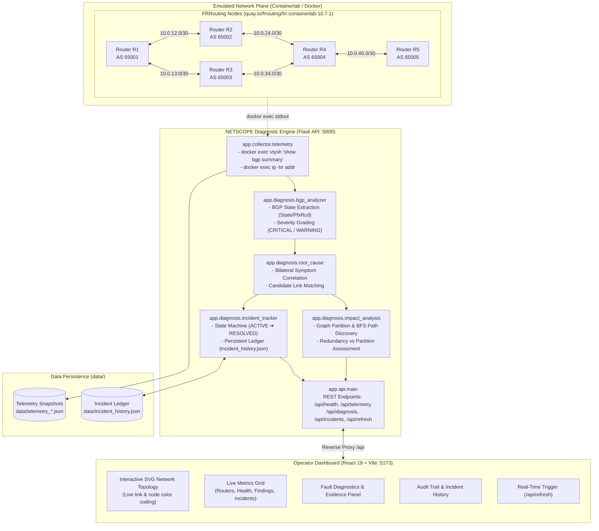
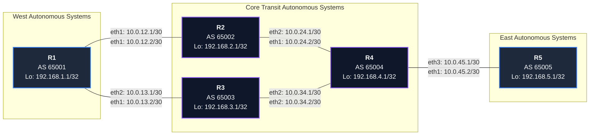
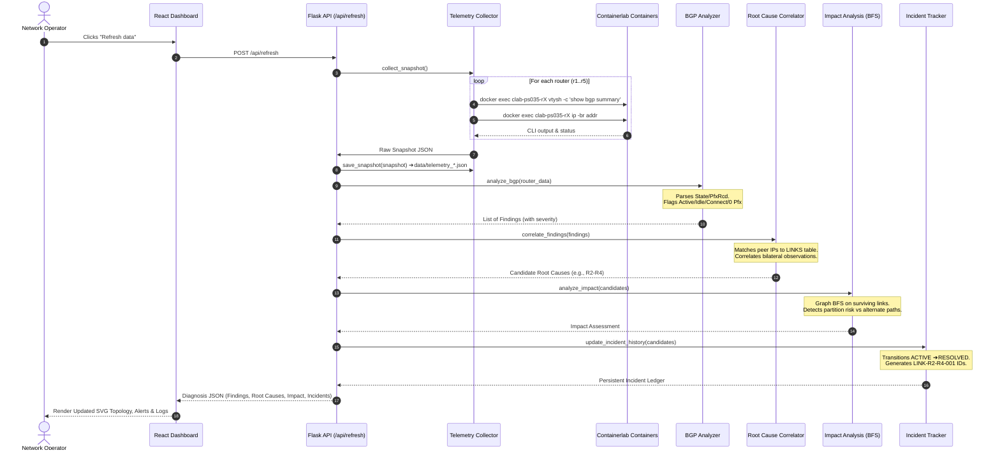
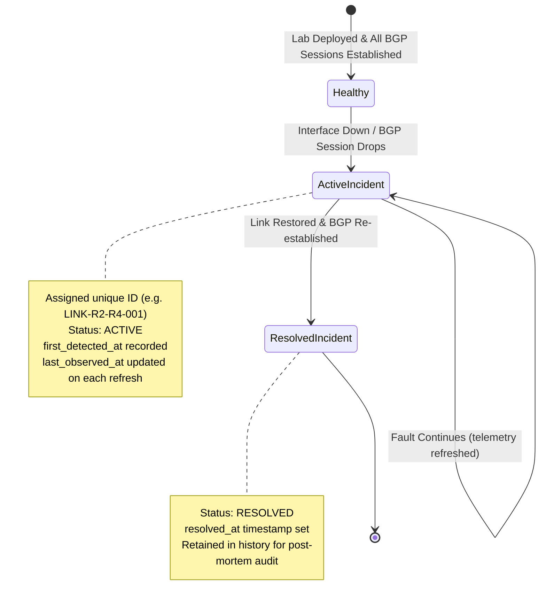
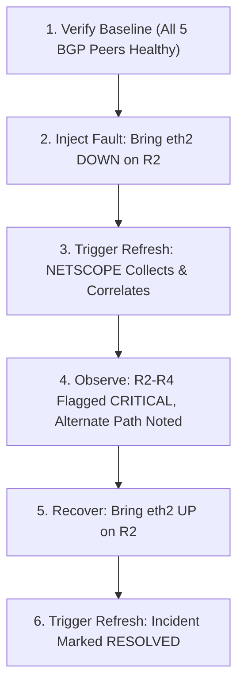

# NETSCOPE · PS-035: Evidence-Based Operator Network Fault Localisation

[](https://youtu.be/nVIh0pni0wo)
[](https://youtu.be/nVIh0pni0wo)
[-4C1D95.svg?style=flat-square)](https://youtu.be/nVIh0pni0wo)
[-10B981.svg?style=flat-square)](lab/ps035.clab.yml)
[](app/api/main.py)
[](frontend/package.json)
[-brightgreen.svg?style=flat-square)](tests/test_diagnosis.py)

> **NETSCOPE** is an evidence-based network diagnosis and telemetry correlation system built for carrier and enterprise networks. It monitors a live 5-router autonomous system (AS) topology running FRRouting (FRR) inside Containerlab, detects routing anomalies (such as eBGP session dropouts and prefix starvation), correlates bilateral symptoms into candidate link failures, performs graph-theoretic impact analysis, and persists incident lifecycles across a modern web operations center.

---

## 🎥 Team Presentation & Solution Walkthrough

As part of the **AIORI-3 Cybersecurity Hackathon**, our team prepared an introductory walkthrough presenting our understanding of Problem Statement PS-035, the architectural approach, and individual member responsibilities.

▶️ **[Watch the Team Introduction Video on YouTube](https://youtu.be/nVIh0pni0wo)**

---

## Table of Contents

- [1. Executive Summary & Motivation](#1-executive-summary--motivation)
- [2. System Architecture](#2-system-architecture)
- [3. Network Topology Specification](#3-network-topology-specification)
- [4. Diagnostic Engine & Correlation Pipeline](#4-diagnostic-engine--correlation-pipeline)
- [5. Incident Lifecycle & Impact Analysis](#5-incident-lifecycle--impact-analysis)
- [6. Feature Matrix: Implemented vs. Roadmap](#6-feature-matrix-implemented-vs-roadmap)
- [7. Repository Structure](#7-repository-structure)
- [8. Prerequisites & Environment Requirements](#8-prerequisites--environment-requirements)
- [9. Quickstart Guide (Step-by-Step)](#9-quickstart-guide-step-by-step)
  - [Step 1: Deploy the Containerlab Topology](#step-1-deploy-the-containerlab-topology)
  - [Step 2: Set Up and Run the Flask Backend](#step-2-set-up-and-run-the-flask-backend)
  - [Step 3: Set Up and Run the React Dashboard](#step-3-set-up-and-run-the-react-dashboard)
- [10. Dashboard Walkthrough](#10-dashboard-walkthrough)
- [11. Backend REST API Reference](#11-backend-rest-api-reference)
- [12. Controlled Fault Injection & Recovery Runbook](#12-controlled-fault-injection--recovery-runbook)
- [13. Testing & Verification](#13-testing--verification)
- [14. Troubleshooting & Operational FAQ](#14-troubleshooting--operational-faq)
- [15. Limitations & Future Extensions](#15-limitations--future-extensions)
- [16. Team & Submission Details](#16-team--submission-details)

---

## 1. Executive Summary & Motivation

### The Problem
Modern telecommunications and operator backbones are multi-hop, multi-autonomous system (AS) environments. When a physical fiber cut, transceiver failure, or interface degradation occurs:
1. **Alarm Cascades:** The failure does not generate an isolated alarm. Instead, Network Operations Centers (NOCs) receive a torrent of secondary alarms—BGP session drops, route flap damping alerts, OSPF re-convergence notifications, and transit reachability timeouts.
2. **Cognitive Overload & High MTTR:** NOC engineers must manually cross-reference cryptic syslog strings and BGP summary tables across multiple routers while mentally reconstructing dynamic topology maps under high-pressure conditions.
3. **Misdiagnosis Risks:** A failure on an intermediary link (such as R2-R4) generates asymmetric or bilateral symptoms on disparate nodes, causing engineers to troubleshoot healthy routers.

### The Solution: NETSCOPE
**NETSCOPE** bridges the gap between raw telemetry and operator decision-making by replacing guesswork with deterministic, evidence-backed root cause analysis:
- **Telemetry Ingestion:** Connects directly to running router instances (`vtysh` and Linux netlink) to collect ground-truth protocol states without intrusive agent overhead.
- **Rule-Based BGP Analysis:** Deterministically evaluates state machines, identifying sessions stuck in `Active`, `Idle`, or `Connect` states as well as prefix starvation (`0` prefixes received).
- **Topology-Aware Root-Cause Correlation:** Cross-references bilateral failure symptoms across known network links to isolate candidate root causes (e.g., matching R2 and R4 down-events to link `R2-R4`).
- **Graph-Theoretic Impact Estimation:** Runs breadth-first search (BFS) over surviving topology paths to identify connected components, network partition risks, and surviving redundant routes.
- **Stateful Incident Tracking:** Automatically detects, timestamps, and resolves incidents across time, maintaining an auditable JSON ledger.
- **Human-Verifiable Evidence Chains:** Rather than behaving as an opaque "black-box AI", NETSCOPE provides exact router outputs, neighbor IPs, interface states, and severity ratings for every diagnosis.

---

## 2. System Architecture

The following diagram illustrates the complete system architecture, showing data flow from the Containerlab data-plane nodes to the operator web dashboard:



---

## 3. Network Topology Specification

The lab topology is modeled after an operator backbone segment containing edge routers, core transit routers, and customer/upstream peering points. It is defined in [lab/ps035.clab.yml](lab/ps035.clab.yml).

### Visual Network Topology



### Verified Router & Interface Matrix

All parameters below have been verified directly against [lab/ps035.clab.yml](lab/ps035.clab.yml) and the running FRR configuration files in [lab/configs/](lab/configs/):

| Router ID | Local AS | Router-ID | Loopback IP | Interface | Assigned IPv4 Subnet | Peer Router | Remote Peer IP | Remote AS |
| :--- | :--- | :--- | :--- | :--- | :--- | :--- | :--- | :--- |
| **R1** | `65001` | `1.1.1.1` | `192.168.1.1/32` | `eth1`<br/>`eth2` | `10.0.12.1/30`<br/>`10.0.13.1/30` | **R2**<br/>**R3** | `10.0.12.2`<br/>`10.0.13.2` | `65002`<br/>`65003` |
| **R2** | `65002` | `2.2.2.2` | `192.168.2.1/32` | `eth1`<br/>`eth2` | `10.0.12.2/30`<br/>`10.0.24.1/30` | **R1**<br/>**R4** | `10.0.12.1`<br/>`10.0.24.2` | `65001`<br/>`65004` |
| **R3** | `65003` | `3.3.3.3` | `192.168.3.1/32` | `eth1`<br/>`eth2` | `10.0.13.2/30`<br/>`10.0.34.1/30` | **R1**<br/>**R4** | `10.0.13.1`<br/>`10.0.34.2` | `65001`<br/>`65004` |
| **R4** | `65004` | `4.4.4.4` | `192.168.4.1/32` | `eth1`<br/>`eth2`<br/>`eth3` | `10.0.24.2/30`<br/>`10.0.34.2/30`<br/>`10.0.45.1/30` | **R2**<br/>**R3**<br/>**R5** | `10.0.24.1`<br/>`10.0.34.1`<br/>`10.0.45.2` | `65002`<br/>`65003`<br/>`65005` |
| **R5** | `65005` | `5.5.5.5` | `192.168.5.1/32` | `eth1` | `10.0.45.2/30` | **R4** | `10.0.45.1` | `65004` |

### Network Plane Segregation
- **Management Plane (`eth0`):** Managed automatically by Docker/Containerlab on subnet `172.20.20.0/24`. Used strictly for out-of-band management (`docker exec`, telemetry collection, SSH/vtysh).
- **Data & Control Plane (`eth1`, `eth2`, `eth3`):** Point-to-point `/30` links interconnecting routers directly via Linux veth pairs. eBGP runs exclusively over these point-to-point subnets.
- **Prefix Advertisement:** Every router originates its local loopback IP into BGP unicast (`network 192.168.X.1/32`). When the network is healthy, all 5 routers receive prefixes from their peers.

---

## 4. Diagnostic Engine & Correlation Pipeline

NETSCOPE executes a deterministic, multi-stage pipeline on every telemetry snapshot:



### Diagnostic Decision Logic

1. **BGP State Parsing (`app/diagnosis/bgp_analyzer.py`):**
   - In FRRouting, `show bgp summary` outputs peer statistics. The 10th column (`State/PfxRcd`) represents either the integer count of received prefixes (meaning the session is in state `Established`) or a textual state name (e.g., `Idle`, `Active`, `Connect`).
   - If the value is a number $> 0$, the session is **Healthy**.
   - If the value is `0`, a `WARNING` is raised: `NO_PREFIXES_RECEIVED`.
   - If the value is non-numeric, a `CRITICAL` finding is raised: `BGP_SESSION_NOT_ESTABLISHED`.

2. **Root-Cause Correlation (`app/diagnosis/root_cause.py`):**
   - Individual router findings only show one side of a session.
   - The correlator inspects the configured `LINKS` array. When R2 reports `10.0.24.2` down and R4 reports `10.0.24.1` down, the engine groups these bilateral observations into a single unified incident on link **R2-R4** (`10.0.24.0/30`).
   - Unilateral faults (e.g., admin shutdown on one peer) are also correlated to the specific affected link.

---

## 5. Incident Lifecycle & Impact Analysis

### Incident Lifecycle State Machine

Network faults are tracked persistently across refresh cycles in `data/incident_history.json`:



### Graph-Theoretic Impact Analysis (`app/diagnosis/impact_analysis.py`)

When candidate root causes are detected, the impact analyzer:
1. Constructs an adjacency graph of the 5 routers.
2. Removes the candidate failed link(s).
3. Executes a BFS traversal to compute **Connected Components**.
4. Tests whether an **Alternate Path** exists between the disconnected endpoints:
   - For **R1-R2, R1-R3, R2-R4, R3-R4**: The ring topology provides redundant routing (e.g. Traffic between R2 and R4 can divert through `R2-R1-R3-R4`). The impact is classified as:
     `REDUNDANT_PATH_AVAILABLE`
   - For **R4-R5**: R5 is a stub node with a single transit link to R4. A failure of link `R4-R5` partitions the network, isolating R5:
     `NETWORK_PARTITION_RISK`

---

## 6. Feature Matrix: Implemented vs. Roadmap

| Capability / Module | Status | Verified Code Location | Description |
| :--- | :---: | :--- | :--- |
| **5-Router Containerlab Topology** | Verified | `lab/ps035.clab.yml` | 5 FRR 10.7.1 containers with eBGP point-to-point subnets and loopbacks. |
| **Live Telemetry Collector** | Verified | `app/collector/telemetry.py` | Queries containers via `docker exec` for BGP summaries and IP addresses. |
| **Timestamped Telemetry Snapshots** | Verified | `data/telemetry_*.json` | Automatic JSON snapshot persistence with UTC timestamps. |
| **FRR BGP State Parser** | Verified | `app/diagnosis/bgp_analyzer.py` | Analyzes `State/PfxRcd`, categorizing session state and prefix starvation. |
| **Topology-Aware Link Correlator** | Verified | `app/diagnosis/root_cause.py` | Groups bilateral BGP symptoms into candidate link root causes. |
| **Graph-Based Impact Analysis** | Verified | `app/diagnosis/impact_analysis.py` | Graph BFS computing partition risks and redundant path availability. |
| **Persistent Incident Tracker** | Verified | `app/diagnosis/incident_tracker.py` | Assigns IDs (`LINK-X-Y-001`), transitions `ACTIVE` ➔ `RESOLVED`. |
| **Flask REST API (5 Routes)** | Verified | `app/api/main.py` | Provides health, telemetry, diagnosis, incidents, and refresh endpoints. |
| **React 19 Operations Dashboard** | Verified | `frontend/src/App.jsx` | Dark-mode NOC interface with real-time SVG topology visualization. |
| **Automated Unit Testing** | Verified | `tests/test_diagnosis.py` | Validates BGP analyzer and root cause correlation logic. |
| **Active ICMP Ping Probing** | Roadmap | *Planned* | Background ICMP probes across loopback pairs to detect packet loss. |
| **Automated Syslog Ingestion** | Roadmap | *Planned* | Streaming syslog parser for real-time interface flap notifications. |
| **Automated Fault-Injection Suite** | Roadmap | *Planned* | CLI script executing all 5 seeded hackathon fault scenarios in sequence. |
| **AI/ML Secondary Diagnostic Model**| Roadmap | *Optional Extension* | Supervised classification model comparing predictions against baseline. |

---

## 7. Repository Structure

```text
.
├── Proposed-structure-hackathon.pdf          # Official hackathon presentation structure template
├── README.md                                 # Master technical documentation (this file)
├── TEAM-ZNMD - Evidence-Based Network...pdf  # Team ZNMD official hackathon slide deck
│
├── app/                                      # Backend Python service
│   ├── __init__.py
│   ├── api/
│   │   ├── __init__.py
│   │   └── main.py                           # Flask REST API server (:5000)
│   ├── collector/
│   │   ├── __init__.py
│   │   └── telemetry.py                      # Docker exec telemetry extraction & snapshot saver
│   └── diagnosis/
│       ├── __init__.py
│       ├── bgp_analyzer.py                   # Parser for 'show bgp summary' output
│       ├── impact_analysis.py                # Graph BFS path discovery & partition assessment
│       ├── incident_tracker.py               # Stateful incident tracker (data/incident_history.json)
│       └── root_cause.py                     # Bilateral BGP correlation to candidate links
│
├── data/                                     # Telemetry snapshots & persistent history
│   ├── incident_history.json                 # Persistent active and resolved incident records
│   └── telemetry_*.json                      # Raw telemetry snapshots (60+ recorded runs)
│
├── frontend/                                 # Operator web dashboard
│   ├── index.html                            # HTML entry point
│   ├── package.json                          # Dependencies: React 19, Lucide, Recharts
│   ├── vite.config.js                        # Vite bundler config with /api reverse proxy
│   └── src/
│       ├── App.jsx                           # Dashboard layout, SVG topology & diagnostic cards
│       ├── App.css                           # Professional dark-theme stylesheet
│       ├── main.jsx                          # React application root
│       └── assets/                           # Branding assets and SVG icons
│
├── lab/                                      # Containerlab topology and router configurations
│   ├── ps035.clab.yml                        # 5-node FRR network topology specification
│   ├── ps035.clab.yml.annotations.json       # Graph layout coordinates
│   └── configs/
│       ├── daemons                           # FRR daemon activation (zebra=yes, bgpd=yes)
│       ├── vtysh.conf                        # FRR CLI configuration
│       ├── r1/frr.conf                       # Router R1 BGP 65001 configuration
│       ├── r2/frr.conf                       # Router R2 BGP 65002 configuration
│       ├── r3/frr.conf                       # Router R3 BGP 65003 configuration
│       ├── r4/frr.conf                       # Router R4 BGP 65004 configuration
│       └── r5/frr.conf                       # Router R5 BGP 65005 configuration
│
├── src/                                      # AIORI-3 template source root
│   └── README.md                             # Template notes
│
└── tests/                                    # Test suite
    ├── __init__.py
    └── test_diagnosis.py                     # Unit tests for diagnosis and root cause logic
```

---

## 8. Prerequisites & Environment Requirements

### Operating System Requirements
- **Linux (Recommended):** Ubuntu 22.04 LTS or Debian 12 (Kernel 5.15+ with native cgroups v2, network namespace, and veth support).
- **macOS / Windows:** Containerlab requires Linux network namespaces and kernel veth interfaces. To run the lab on macOS or Windows, deploy a Linux virtual machine (using **Multipass**, **Lima**, or **WSL2** on Windows 11 with Docker). The backend and frontend can run either inside the VM or on the host communicating with Docker.

### Software Dependencies
| Software | Required Version | Purpose |
| :--- | :--- | :--- |
| **Docker** | `>= 24.0.0` | Container runtime managing router containers. |
| **Containerlab (`clab`)** | `>= 0.50.0` | Orchestrates the multi-node network lab topology. |
| **Python** | `>= 3.10` | Runs the telemetry collector, diagnostic engine, and Flask API. |
| **Node.js** | `>= 18.0.0` | Runs the Vite development server and builds the React frontend. |
| **npm** | `>= 9.0.0` | Node package manager. |

---

## 9. Quickstart Guide (Step-by-Step)

Follow these steps to deploy the complete system from scratch.

### Step 1: Deploy the Containerlab Topology

> [!NOTE]
> Containerlab requires root/sudo privileges to create Linux network namespaces, bridges, and virtual ethernet pairs.

Open a terminal on your Linux host:

```bash
# Navigate to the lab directory
cd lab

# Deploy the 5-router topology using Containerlab
sudo clab deploy -t ps035.clab.yml
```

Verify that all five router containers are running:
```bash
docker ps --filter "name=clab-ps035"
```

*Expected output:*
```text
CONTAINER ID   IMAGE                                         COMMAND                  CREATED         STATUS         NAMES
xxxxxxxxxxxx   quay.io/frrouting/frr:containerlab-10.7.1     "/usr/lib/frr/docker…"   1 minute ago    Up 1 minute    clab-ps035-r1
xxxxxxxxxxxx   quay.io/frrouting/frr:containerlab-10.7.1     "/usr/lib/frr/docker…"   1 minute ago    Up 1 minute    clab-ps035-r2
xxxxxxxxxxxx   quay.io/frrouting/frr:containerlab-10.7.1     "/usr/lib/frr/docker…"   1 minute ago    Up 1 minute    clab-ps035-r3
xxxxxxxxxxxx   quay.io/frrouting/frr:containerlab-10.7.1     "/usr/lib/frr/docker…"   1 minute ago    Up 1 minute    clab-ps035-r4
xxxxxxxxxxxx   quay.io/frrouting/frr:containerlab-10.7.1     "/usr/lib/frr/docker…"   1 minute ago    Up 1 minute    clab-ps035-r5
```

Verify BGP peering on router R1:
```bash
docker exec -it clab-ps035-r1 vtysh -c "show bgp summary"
```

---

### Step 2: Set Up and Run the Flask Backend

In a **new terminal**, navigate to the project root directory:

```bash
cd /path/to/A3-PS035-TC262

# Create and activate a Python virtual environment
python3 -m venv venv
source venv/bin/activate

# Install Flask
pip install flask

# Start the Flask API server
python3 -m app.api.main
```

*Expected output:*
```text
 * Serving Flask app 'app.api.main'
 * Debug mode: off
 * Running on all addresses (0.0.0.0)
 * Running on http://127.0.0.1:5000
 * Running on http://<host-ip>:5000
```

Verify the API health check in a separate shell:
```bash
curl http://127.0.0.1:5000/api/health
# Response: {"service":"PS-035 Network Diagnosis API","status":"ok"}
```

---

### Step 3: Set Up and Run the React Dashboard

In a **third terminal**, navigate to the `frontend/` directory:

```bash
cd /path/to/A3-PS035-TC262/frontend

# Install Node dependencies
npm install

# Start the Vite development server
npm run dev
```

*Expected output:*
```text
  VITE v8.3.4  ready in 180 ms

  ➜  Local:   http://localhost:5173/
  ➜  Network: http://<host-ip>:5173/
  ➜  press h + enter to show help
```

Open your browser and navigate to:
```text
http://localhost:5173
```

---

### Tearing Down the Lab
To cleanly destroy the containers and network links when finished:
```bash
cd lab
sudo clab destroy -t ps035.clab.yml
```

---

## 10. Dashboard Walkthrough

The NETSCOPE dashboard is organized into purposeful operational panels:

```text
+------------------------------------------------------------------------------------------+
|  NETSCOPE · NETWORK INTELLIGENCE                           [● Backend API: Connected]    |
+------------------------------------------------------------------------------------------+
|  NETWORK OPERATIONS CENTER                                                               |
|  Network Overview · Monitor routing health & investigate faults       [ ⟳ Refresh data ] |
+------------------------------------------------------------------------------------------+
|  [ ROUTERS MONITORED: 5 ]  [ HEALTHY: 5/5 ]  [ FINDINGS: 0 ]  [ CORRELATED INCIDENTS: 0 ]|
+------------------------------------------------------------------------------------------+
|  NETWORK TOPOLOGY (Interactive SVG)                                                      |
|                                                                                          |
|       ( R1 )=========================( R2 )                                              |
|         ||                             \\                                                |
|         ||                              \\                                               |
|       ( R3 )=========================( R4 )=========================( R5 )               |
|                                                                                          |
|   Links: [● R1-R2] [● R1-R3] [● R2-R4] [● R3-R4] [● R4-R5]   (Green = OK, Red = Fault)   |
+------------------------------------------------------------------------------------------+
|  FAULT DIAGNOSTICS (0 Findings)             |  ROOT-CAUSE CANDIDATES (0 Incidents)       |
|  "No BGP findings detected in snapshot"     |  "Correlated candidates appear upon fault" |
+------------------------------------------------------------------------------------------+
|  INCIDENT HISTORY (0 Active / 2 Resolved)                                                |
|  LINK-R2-R4-001 · Resolved at 11:47 UTC · BGP session re-established                     |
+------------------------------------------------------------------------------------------+
|  ROUTER INVENTORY (5 Devices: R1, R2, R3, R4, R5)                                        |
+------------------------------------------------------------------------------------------+
```

1. **Header & Status Bar:** Displays connection status to the backend API (`Connected` / `Disconnected`) and the exact UTC timestamp of the active telemetry snapshot.
2. **Key Metric Cards:**
   - **Routers Monitored:** Total network nodes present in telemetry (5).
   - **Healthy Routers:** Count of routers with 100% clean BGP sessions and successful telemetry polling.
   - **Active Findings:** Raw BGP anomalies parsed from `show bgp summary`.
   - **Correlated Incidents:** Distinct candidate link root causes.
3. **Interactive Network Topology Canvas:**
   - Real-time SVG rendering of the 5 nodes with connecting path lines.
   - Lines dynamically transition to pulsing red when a candidate fault affects the link.
   - Router nodes reflect collection health and alert status.
4. **Fault Diagnostics Panel:** Displays granular findings with severity badges (`CRITICAL`, `WARNING`), affected router, neighbor IP, and diagnostic message.
5. **Root-Cause Candidates Panel:** Shows correlated link candidates, observation count across affected routers, unified evidence string, and BFS impact assessment.
6. **Incident History Panel:** A persistent ledger showing active and resolved incidents with first-detected, last-observed, and resolved timestamps.
7. **Router Inventory:** Grid of device cards showing device state, interface health, and individual finding counts.

---

## 11. Backend REST API Reference

The backend runs on `http://127.0.0.1:5000` (or `http://localhost:5173/api` via Vite proxy).

### Endpoints Overview

| Method | Endpoint | Description |
| :--- | :--- | :--- |
| `GET` | `/api/health` | Health check endpoint returning service name and status. |
| `GET` | `/api/telemetry` | Returns the most recently saved raw telemetry snapshot. |
| `GET` | `/api/diagnosis` | Runs the diagnostic engine against the latest saved snapshot. |
| `GET` | `/api/incidents` | Retrieves the persistent incident history ledger. |
| `POST` | `/api/refresh` | Executes live collection from all 5 routers, diagnoses findings, updates incident history, and returns full diagnostic state. |

---

### Detailed Endpoint Specifications

#### 1. `GET /api/health`
- **Purpose:** Verifies that the Flask application is running.
- **Example Request:**
  ```bash
  curl -s http://127.0.0.1:5000/api/health
  ```
- **Example Response:**
  ```json
  {
    "service": "PS-035 Network Diagnosis API",
    "status": "ok"
  }
  ```

---

#### 2. `GET /api/telemetry`
- **Purpose:** Retrieves the latest snapshot stored in `data/telemetry_*.json`.
- **Response Codes:** `200 OK` on success, `404 Not Found` if no snapshots exist.
- **Example Response (Truncated for brevity):**
  ```json
  {
    "collected_at": "2026-10-20T12:03:27.830302+00:00",
    "project": "PS-035",
    "routers": [
      {
        "router": "r1",
        "collected_at": "2026-10-20T12:03:28.015796+00:00",
        "healthy_collection": true,
        "bgp": {
          "success": true,
          "return_code": 0,
          "output": "IPv4 Unicast Summary:\nBGP router identifier 1.1.1.1, local AS number 65001...\nNeighbor 10.0.12.2 ... State/PfxRcd 1\nNeighbor 10.0.13.2 ... State/PfxRcd 3",
          "error": ""
        },
        "interfaces": {
          "success": true,
          "return_code": 0,
          "output": "lo UNKNOWN 127.0.0.1/8 192.168.1.1/32\neth1 UP 10.0.12.1/30\neth2 UP 10.0.13.1/30",
          "error": ""
        }
      }
    ]
  }
  ```

---

#### 3. `GET /api/diagnosis`
- **Purpose:** Evaluates the latest telemetry snapshot and returns detected findings, candidate root causes, and graph impact analysis.
- **Example Response (When Link R2-R4 has failed):**
  ```json
  {
    "snapshot_timestamp": "2026-10-20T12:03:27.830302+00:00",
    "routers_analyzed": 5,
    "finding_count": 2,
    "findings": [
      {
        "router": "R2",
        "severity": "CRITICAL",
        "type": "BGP_SESSION_NOT_ESTABLISHED",
        "neighbor": "10.0.24.2",
        "remote_as": 65004,
        "state": "Idle",
        "message": "BGP neighbor 10.0.24.2 on R2 is in state Idle, not Established."
      },
      {
        "router": "R4",
        "severity": "CRITICAL",
        "type": "BGP_SESSION_NOT_ESTABLISHED",
        "neighbor": "10.0.24.1",
        "remote_as": 65002,
        "state": "Active",
        "message": "BGP neighbor 10.0.24.1 on R4 is in state Active, not Established."
      }
    ],
    "candidate_root_causes": [
      {
        "candidate_link": "R2-R4",
        "subnet": "10.0.24.0/30",
        "severity": "CRITICAL",
        "fault_type": "CORRELATED_BGP_INCIDENT",
        "observation_count": 2,
        "affected_routers": ["R2", "R4"],
        "observations": [
          {
            "router": "R2",
            "neighbor": "10.0.24.2",
            "severity": "CRITICAL",
            "fault_type": "BGP_SESSION_NOT_ESTABLISHED",
            "message": "BGP neighbor 10.0.24.2 on R2 is in state Idle, not Established."
          },
          {
            "router": "R4",
            "neighbor": "10.0.24.1",
            "severity": "CRITICAL",
            "fault_type": "BGP_SESSION_NOT_ESTABLISHED",
            "message": "BGP neighbor 10.0.24.1 on R4 is in state Active, not Established."
          }
        ],
        "evidence": "BGP neighbor 10.0.24.2 on R2 is in state Idle, not Established. BGP neighbor 10.0.24.1 on R4 is in state Active, not Established.",
        "assessment": "Multiple BGP observations implicate this link. This is a candidate root cause, not proof of a physical link failure. Verify both endpoints."
      }
    ],
    "impact_analysis": {
      "analysis_type": "TOPOLOGY_BASED_ESTIMATE",
      "routers_in_topology": 5,
      "failed_links_assumed": 1,
      "connected_components": [["R1", "R2", "R3", "R4", "R5"]],
      "affected_links": [
        {
          "link": "R2-R4",
          "subnet": "10.0.24.0/30",
          "alternate_path_exists": true,
          "impact": "REDUNDANT_PATH_AVAILABLE",
          "assessment": "The topology contains an alternate path between these routers, but live routing must be verified."
        }
      ],
      "limitations": "This estimates connectivity from the configured topology and candidate incidents. It does not confirm live route reachability or identify lost prefixes."
    }
  }
  ```

---

#### 4. `GET /api/incidents`
- **Purpose:** Reads the persistent incident ledger from `data/incident_history.json`.
- **Example Response:**
  ```json
  {
    "incidents": [
      {
        "incident_id": "LINK-R2-R4-001",
        "candidate_link": "R2-R4",
        "subnet": "10.0.24.0/30",
        "status": "ACTIVE",
        "severity": "CRITICAL",
        "first_detected_at": "2026-10-20T11:53:38.170905+00:00",
        "last_observed_at": "2026-10-20T12:03:28.274593+00:00",
        "resolved_at": null,
        "affected_routers": ["R2", "R4"],
        "evidence": "BGP neighbor 10.0.24.2 on R2 is in state Idle, not Established...",
        "assessment": "Multiple BGP observations implicate this link..."
      }
    ]
  }
  ```

---

#### 5. `POST /api/refresh`
- **Purpose:** Triggers live collection from the running Docker containers, writes a new snapshot to `data/telemetry_<timestamp>.json`, evaluates the diagnosis, updates incident history, and returns the unified result.
- **Example Request:**
  ```bash
  curl -X POST http://127.0.0.1:5000/api/refresh
  ```
- **Example Response Fields:** Returns the complete diagnosis object alongside a `collection` metadata block:
  ```json
  {
    "collection": {
      "routers_ok": 5,
      "routers_total": 5,
      "snapshot_file": "data/telemetry_20261020T120328Z.json",
      "status": "completed"
    },
    "incidents": [ ... ],
    "candidate_root_causes": [ ... ],
    "findings": [ ... ],
    "impact_analysis": { ... }
  }
  ```

---

## 12. Controlled Fault Injection & Recovery Runbook

This guide demonstrates how to simulate a network link degradation/cut, observe NETSCOPE's diagnosis, and verify recovery.

> [!CAUTION]
> Execute fault-injection commands **only** inside specific lab containers as shown. Do not run network interface modification commands on the physical host.

### Scenario: Simulating a Failure on Link R2-R4 (`10.0.24.0/30`)



#### Step 1: Check Baseline Health
Ensure all routers are peered and established:
```bash
docker exec clab-ps035-r2 vtysh -c "show bgp summary"
docker exec clab-ps035-r4 vtysh -c "show bgp summary"
```
*Observe that neighbors `10.0.24.2` and `10.0.24.1` show positive prefix counts (e.g. `State/PfxRcd: 1` or higher).*

#### Step 2: Inject the Fault
Disable interface `eth2` on router R2 (the interface connected to R4):
```bash
docker exec clab-ps035-r2 ip link set eth2 down
```

*(Alternative method via FRR CLI):*
```bash
docker exec clab-ps035-r2 vtysh \
  -c "configure terminal" \
  -c "router bgp 65002" \
  -c "neighbor 10.0.24.2 shutdown"
```

#### Step 3: Trigger Telemetry Refresh
In the web dashboard, click **Refresh data**, or send a POST request via curl:
```bash
curl -X POST http://127.0.0.1:5000/api/refresh
```

#### Step 4: Verify Diagnostic Results
1. **Raw Findings:**
   - Router `R2` reports: `BGP neighbor 10.0.24.2 on R2 is in state Idle, not Established.`
   - Router `R4` reports: `BGP neighbor 10.0.24.1 on R4 is in state Active, not Established.`
2. **Correlated Root Cause:**
   - Candidate Link: **R2-R4** (`10.0.24.0/30`)
   - Severity: **CRITICAL**
   - Affected Routers: `["R2", "R4"]`
3. **Impact Analysis:**
   - `impact`: `REDUNDANT_PATH_AVAILABLE`
   - Assessment notes that traffic between R2 and R4 can alternate through `R2-R1-R3-R4`.
4. **Dashboard View:**
   - The line connecting R2 and R4 turns red.
   - An active incident appears in the **Incident History** ledger.

#### Step 5: Restore the Link
Bring the interface back up:
```bash
docker exec clab-ps035-r2 ip link set eth2 up
```

*(If using the FRR vtysh alternative):*
```bash
docker exec clab-ps035-r2 vtysh \
  -c "configure terminal" \
  -c "router bgp 65002" \
  -c "no neighbor 10.0.24.2 shutdown"
```

#### Step 6: Verify Recovery
Wait 5–10 seconds for the BGP session to re-establish:
```bash
docker exec clab-ps035-r2 vtysh -c "show bgp summary"
```

Click **Refresh data** on the dashboard:
- Active findings return to `0`.
- Link R2-R4 returns to **healthy** (green).
- Incident `LINK-R2-R4-001` transitions to status **RESOLVED** with an updated `resolved_at` timestamp.

---

## 13. Testing & Verification

The repository includes automated unit tests verifying the BGP parsing and root-cause correlation logic.

### Running Unit Tests
From the project root:
```bash
python3 -m unittest discover tests -v
```

*Expected output:*
```text
test_active_neighbor_is_detected_and_correlated (tests.test_diagnosis.DiagnosisTests.test_active_neighbor_is_detected_and_correlated) ... ok
test_healthy_neighbor_produces_no_findings (tests.test_diagnosis.DiagnosisTests.test_healthy_neighbor_produces_no_findings) ... ok

----------------------------------------------------------------------
Ran 2 tests in 0.001s

OK
```

### Test Coverage Highlights
- `test_active_neighbor_is_detected_and_correlated`: Simulates raw `show bgp summary` text where neighbor `10.0.13.2` is in state `Active`. Verifies that:
  1. `analyze_bgp` flags `BGP_SESSION_NOT_ESTABLISHED`.
  2. `correlate_findings` correctly maps the neighbor IP to candidate link `R1-R3` on subnet `10.0.13.0/30`.
- `test_healthy_neighbor_produces_no_findings`: Supplies clean BGP output where all neighbors show established prefix counts. Asserts that the findings list is strictly empty.

---

## 14. Troubleshooting & Operational FAQ

### 1. `docker: command not found` or permission denied
- **Symptom:** `app.collector.telemetry` prints collection errors with `permission denied`.
- **Fix:** Ensure the current user has access to Docker without sudo (`sudo usermod -aG docker $USER`), or start the Flask backend with appropriate permissions.

### 2. Telemetry Refresh Fails: `Telemetry collected from 0 of 5 routers`
- **Symptom:** The dashboard displays an error banner: `Telemetry collected from 0 of 5 routers`.
- **Cause:** The Containerlab topology is not currently deployed, or container names do not match `clab-ps035-r1` through `clab-ps035-r5`.
- **Fix:** Check container status via `docker ps --filter "name=clab-ps035"`. If empty, run `sudo clab deploy -t lab/ps035.clab.yml`.

### 3. BGP Sessions Remain in `Connect` or `Active` State After Deploy
- **Cause:** FRRouting daemons take 5–15 seconds to initialize TCP handshakes on port 179 across veth links.
- **Fix:** Inspect the router routing table:
  ```bash
  docker exec clab-ps035-r1 vtysh -c "show ip route"
  ```
  Ensure point-to-point interface routes (`10.0.12.0/30`, etc.) are in state `K>*` (Kernel).

### 4. Frontend Fails to Communicate with API (`API Disconnected`)
- **Symptom:** The dashboard displays `API Disconnected` in the sidebar.
- **Fix:** Verify that the Flask API is running on port 5000 (`curl http://127.0.0.1:5000/api/health`). Check that `frontend/vite.config.js` proxies `/api` to `http://127.0.0.1:5000`.

---

## 15. Limitations & Future Extensions

### Known Limitations
1. **Topology Impact Estimation vs. Live RIB:** `impact_analysis.py` computes connected components from static graph definitions and active incidents. It identifies whether topological bypass paths exist, but does not independently verify live route convergence or withdrawn prefix announcements.
2. **Synchronous Polling:** Telemetry collection currently runs synchronously via Docker CLI execution upon a `/api/refresh` request rather than an asynchronous streaming telemetry daemon.
3. **Environment:** Containerlab requires a Linux environment (or a Linux VM on macOS/Windows) due to kernel network namespace constraints.

### Proposed Roadmap Extensions
- [ ] **Asynchronous Syslog Receiver:** An integrated syslog daemon (RFC 5424) listening for immediate link down/up traps.
- [ ] **Active ICMP Probe Matrix:** Periodic ping meshes across loopbacks (`192.168.1.1` to `192.168.5.1`) to detect asymmetric latency and packet loss.
- [ ] **Automated Benchmark Scenario Runner:** A test harness executing all 5 seeded hackathon fault scenarios, evaluating Top-1 and Top-3 accuracy against ground truth.
- [ ] **Machine Learning Diagnostic Model:** An optional supervised classification model evaluated in tandem with the rule-based baseline.

---

## 16. Team & Submission Details

- **Hackathon:** AIORI-3 — Cybersecurity
- **Problem Statement:** PS-035 (Evidence-Based Operator Network Fault Localisation)
- **Team Code:** A3-PS035-TC262
- **Team Name:** TEAM-ZNMD
- **Video Submission:** [Watch Team Introduction on YouTube](https://youtu.be/nVIh0pni0wo)

---

## 17. License

This repository and its source code are prepared for the **AIORI-3 Cybersecurity Hackathon**. Please refer to repository commit history and official competition guidelines regarding distribution and licensing.
